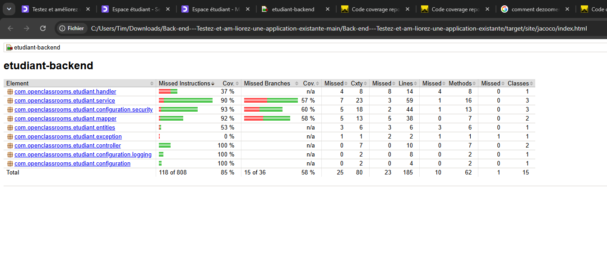
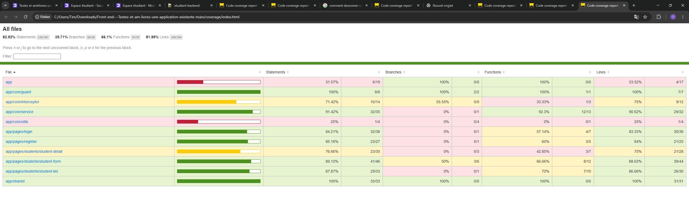
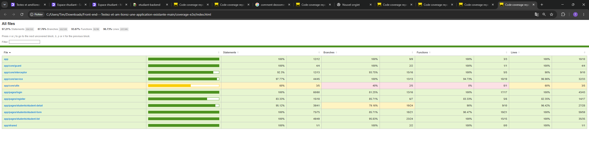

# Projet 2 – Testez et améliorez une application existante

Projet réalisé dans le cadre de ma formation Architecte Logiciel chez OpenClassrooms.

L'application sert aux agents d'une bibliothèque. Au départ, on pouvait seulement s'inscrire. J'ai réparé la connexion, ajouté la gestion des étudiants (ajout, liste, détail, modification, suppression), puis j'ai écrit les tests unitaires, d'intégration et E2E.

## Contenu du repo

- `back/` : l'API en Spring Boot (Java 21), avec une base MySQL lancée par Docker
- `front/` : l'application Angular
- `rapports/` : les captures de mes rapports de couverture

## Lancer le projet

Il faut Java 21, Node.js et Docker Desktop.

Pour le back :
1. copier `back/.env.example` en `back/.env` et mettre une clé dans `JWT_SECRET` (clé en Base64)
2. lancer Docker Desktop
3. dans `back/`, lancer `./mvnw spring-boot:run` (l'API tourne sur le port 8080)

Pour le front : dans `front/`, lancer `npm install` puis `npm start` (l'appli tourne sur http://localhost:4200).

## Lancer les tests

- Back (JUnit, Mockito, Testcontainers) : `./mvnw clean verify` dans `back/`, avec Docker lancé
- Front (Jest) : `npx jest` dans `front/`
- E2E (Cypress) : `npm run e2e` dans `front/`

Le seuil de couverture est de 80 % : si on passe en dessous, les tests échouent.

## Résultats

| Tests | Nombre | Couverture des lignes |
| --- | --- | --- |
| Back (unitaires + intégration) | 25 | 87,6 % |
| Front Jest (unitaires + intégration) | 22 | 82,0 % |
| E2E Cypress | 4 scénarios | 96,7 % |

**Back – JaCoCo**

**Front – Jest**

**E2E – Cypress**

